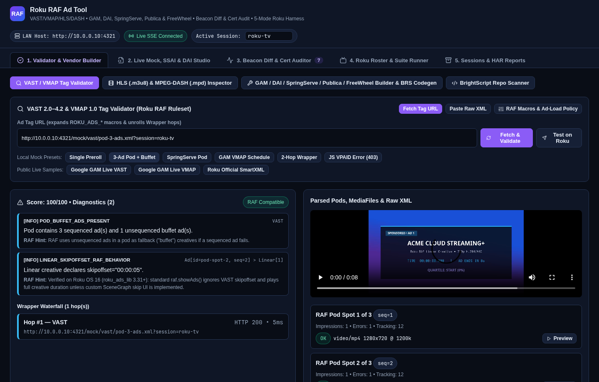
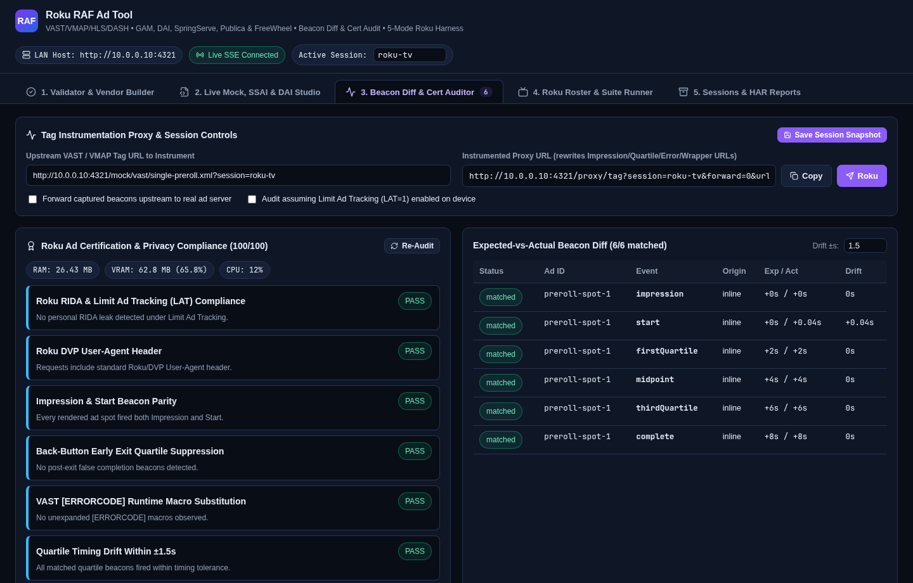
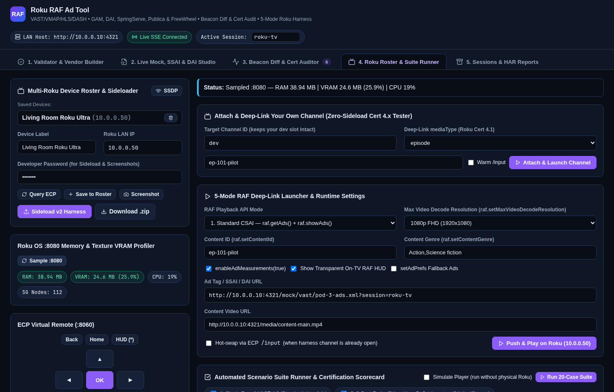

# Roku RAF Ad Tool

Unified engineering, debugging, and certification workbench for the **Roku Advertising Framework (RAF)** — built for **both humans (5-tab Web Workbench + Roku SceneGraph TV UI) and AI agents (`raf --json` CLI, MCP server, `/llms.txt`, and OpenAPI)**.

Covers static BrightScript channel scanning, **CSAI (VAST 2.0–4.2 / VMAP 1.0 / FreeWheel SmartXML)**, **Client-Stitched Pods**, **Custom Skippable SceneGraph UI**, **VOD & Live Linear SSAI (`#EXT-X-DATERANGE` / SCTE-35)**, **MPEG-DASH (`.mpd`)**, and **Google Ad Manager DAI**.



| Expected-vs-Actual Beacon & Certification Auditor | Roku Roster, `:8080` Profiler & 20-Case Suite |
| :---: | :---: |
|  |  |

---

## Core Capabilities

### 1. Validator, Manifest Inspector, Vendor Builder & BrightScript Repo Scanner
- **Static BrightScript / SceneGraph Channel Scanner (`raf scan-repo`)**: Scans any Roku channel directory (`manifest`, `source/*.brs`, `components/*.xml`, `components/*.brs`) for missing `bs_libs_required=roku_ads_lib`, SceneGraph Render-Thread violations, RIDA/Limit-Ad-Tracking privacy leaks, missing Nielsen/OMID metadata, and Roku OS 16 runtime/compiler traps.
- **VAST / VMAP / FreeWheel SmartXML Validator**: Unrolls `<Wrapper>` chains, expands `ROKU_ADS_*` macros, previews MP4 creatives, and validates Roku codec, bitrate, pod sequence, `skipoffset`, and buffet fallback rules.
- **HLS (`.m3u8`) & MPEG-DASH (`.mpd`) Inspector**: Parses multivariant & media playlists, `#EXT-X-DISCONTINUITY`, `#EXT-X-DATERANGE`, `#EXT-X-CUE-OUT`, `#EXT-X-OATCLS-SCTE35`, and DASH `<EventStream>` cues.
- **Vendor Request Builder & BrightScript Code Generator**: Builds and audits ad requests for **GAM**, **Google DAI (VOD & Live)**, **SpringServe**, **Publica**, and **FreeWheel** (verifying RIDA, `is_lat`/`dnt`/`lmt`, `us_privacy`, `gpp`, `correlator`) and generates copy-ready `Roku_Ads.brs` SceneGraph Task snippets.

### 2. Live Mock Ad, SSAI, Google DAI & Chaos Fault Studio
- **Live Linear HLS Sliding-Window Server** (`/mock/live/master.m3u8`) with real-time **"Cue Live SCTE-35 / DATERANGE Ad Break Now"** injection.
- **Ad Chaos & Network Fault Injector (`/api/chaos` / `?chaos=`)**: Simulate `HTTP 503`, `HTTP 429`, `corrupt-xml`, `empty-vast-303`, mid-chain wrapper drops (`drop-wrapper-hop`), broken MP4 CDNs (`media-500`), and socket hangs (`timeout-hang`) to verify Roku channels fall back to content instead of freezing on a black spinner.
- **Google DAI VOD & Live Emulator** (`POST /mock/dai/ondemand/...` & `POST /mock/dai/live/...`).
- Built-in & SQLite-persisted custom VAST/VMAP/Pod/Wrapper/Error endpoints with auto-generated animated commercials, HLS `.ts` segments, and MPEG-DASH `.mpd` streams.

### 3. Expected-vs-Actual Beacon Diff, Roku Ad-Load Policy & Certification Auditor
- **Tag Instrumentation Proxy (`/proxy/tag`)**: Intercepts and optionally forwards (`forward=1`) beacons and nested VMAP/Wrapper hops from external ad servers (e.g. Google Ad Manager).
- **Roku Ad-Load Certification Policies**: Audits VMAP & SmartXML schedules against Roku Certification rules (prohibiting midrolls on `<15m` `shortFormVideo`, enforcing `>= 7 min` midroll spacing, and checking pod duration/spot caps).
- Reconciles expected vs. fired beacons with **`±s` quartile timing drift** detection, **Ad `TTFF` (ms)** startup metrics, and intentional post-skip/early-exit quartile suppression.
- Evaluates **9 Roku Ad Certification & Privacy Checks**: RIDA + Limit Ad Tracking (`LAT=1`) leak check, `Roku/DVP` User-Agent, Impression/Start parity, Back-button early exit suppression, `[ERRORCODE]` macro substitution, quartile drift, `:8085` BrightScript compile/runtime crash detection, `:8080` Texture VRAM headroom, and LAN firewall reachability.

### 4. Multi-Roku Roster, `:8080` Memory/VRAM Profiler, External Channel Attach & 20-Case Suite Runner
- **Attach to Your Own Channel (`raf attach`)**: Deep-link cold (`/launch`) or warm (`/input`) into any channel already installed in `dev` (`contentId` + `mediaType` Roku Cert 4.x) **without** overwriting `dev`, while monitoring `:8085` RAF logs and `:8080` memory/VRAM live.
- **Roku OS `:8080` Profiler (`raf perf`)**: Samples `chanperf`, `r2d2_bitmaps`, and `sgnodes` for live Channel RAM (MB), CPU %, GPU Texture VRAM utilization %, and SceneGraph node counts.
- Complete sideloadable Roku channel (`roku-channel/`) supporting **Standard CSAI (`showAds`)**, **Client-Stitched Pods (`constructStitchedStream`)**, **Custom SceneGraph Skippable UI (`csai-skippable`)**, **VOD & Live SSAI (`stitchedAdsInit`)**, and **Google DAI**, plus a toggleable on-TV **RAF Debug HUD (`*`)** and `roRegistry` tag bookmarks.
- SSDP device discovery, pure-Node PKZIP packaging + HTTP Digest sideloading (`/plugin_install`), `/plugin_inspect` screenshot capture, `:8085` debug console bridge, and a **20-scenario Automated Certification & Chaos Suite Runner** (hardware or `--simulate` mode).

### 5. Sessions, Snapshots & HAR Traffic Importer
- Stores test sessions in local SQLite (`node:sqlite`), imports Charles / mitmproxy `.har` captures (sample included in `samples/public-gam-roku-capture.har`), and exports `.json` bundles or `.md` QA Certification Reports.

---

## Prerequisites & Quick Start

- **Node.js `>= 22`** (uses built-in `node:sqlite`)
- **`ffmpeg`** *(optional — automatically generates rich animated 720p commercials, HLS, and DASH media; falls back to valid embedded test clips if absent)*

```bash
npm install
cp .env.example .env   # Optional: set ROKU_IP and ROKU_DEV_PASSWORD
npm run build
npm start
```

- **Web Workbench**: `http://127.0.0.1:4321` (or `npm run dev` for Vite HMR on `http://localhost:5173`)
- **Roku LAN Setup**: Ensure your Roku has **Developer Mode** enabled (`Home 3x, Up 2x, Right, Left, Right, Left, Right`) and that your computer's firewall allows inbound TCP port `4321` from your Roku's LAN IP so the TV can fetch mock/proxied streams.

---

## CLI (`raf`) & MCP Server

Link the CLI globally with `npm link` (or run via `npm run raf -- ...`). Add `--json` to any command for structured agent output:

```bash
raf status --json
raf scan-repo ./roku-channel --json
raf validate "http://127.0.0.1:4321/mock/vast/pod-3-ads.xml" --json
raf inspect-manifest "http://127.0.0.1:4321/mock/ssai/stream.m3u8" --json
raf sideload --ip <roku-ip> --password <dev-password> --json
raf attach --ip <roku-ip> --channel dev --content-id ep-101 --media-type episode --json
raf perf --ip <roku-ip> --json
raf chaos --mode http-503 --json
raf run --ip <roku-ip> --scenario single-preroll --mode csai --screenshot --json
raf suite --simulate --json          # Offline CI / agent simulation
raf suite --ip <roku-ip> --json      # Full 20-case physical Roku hardware & chaos suite
raf har ./samples/public-gam-roku-capture.har --json
```

### MCP Stdio Configuration (`mcp_config.json`)

```json
{
  "mcpServers": {
    "roku-raf-ad-tool": {
      "command": "npx",
      "args": ["tsx", "/path/to/roku-raf-ad-tool/src/mcp/server.ts"]
    }
  }
}
```

---

## Verification

```bash
npm run verify      # Media generation + TypeScript check + Vitest unit/API/MCP tests
npm run test:e2e    # Playwright 5-tab Chromium E2E test
```

## License

[MIT](./LICENSE)
